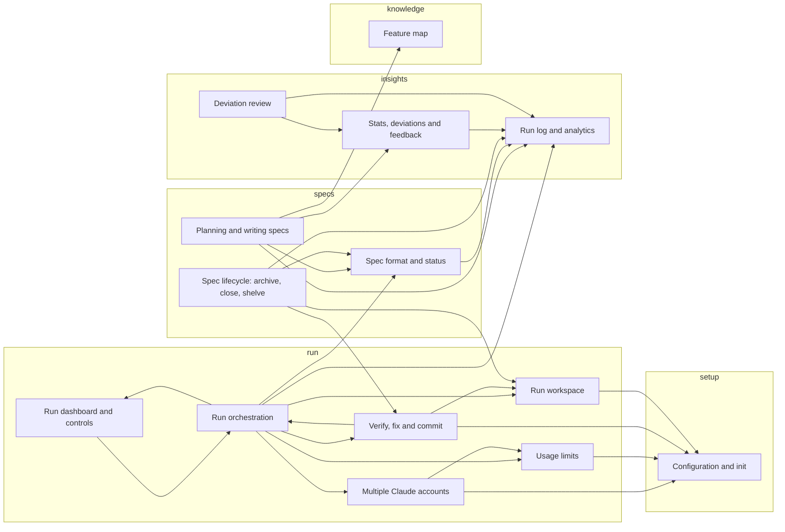

# specrun feature map

specrun runs implementation specs task by task with Claude agents, unattended, and records what
happened. The map lists what users can do with it, not how it is built.

## Features

| ID                                                | Title                                  | Summary                                                                  |
| ------------------------------------------------- | -------------------------------------- | ------------------------------------------------------------------------ |
| [insights/review](insights/review.md)             | Deviation review                       | Settle agents' reported deviations with Claude Code                      |
| [insights/run-log](insights/run-log.md)           | Run log and analytics                  | See task status, progress and session analytics derived from the run log |
| [insights/stats](insights/stats.md)               | Stats, deviations and feedback         | See cost and deviations of finished runs and get improvement proposals   |
| [knowledge/feature-map](knowledge/feature-map.md) | Feature map                            | Check, bootstrap and update the map of what the product does             |
| [run/accounts](run/accounts.md)                   | Multiple Claude accounts               | Spread runs over several Claude accounts with priority and fallback      |
| [run/dashboard](run/dashboard.md)                 | Run dashboard and controls             | Watch a run live and steer it                                            |
| [run/limits](run/limits.md)                       | Usage limits                           | Let runs wait out plan usage limits                                      |
| [run/orchestration](run/orchestration.md)         | Run orchestration                      | Run a spec's tasks unattended, one agent session each                    |
| [run/verify-commit](run/verify-commit.md)         | Verify, fix and commit                 | Verify each task's work and commit it when green                         |
| [run/workspace](run/workspace.md)                 | Run workspace                          | Run in an isolated worktree and branch                                   |
| [setup/config](setup/config.md)                   | Configuration and init                 | Configure specrun for a repo                                             |
| [specs/authoring](specs/authoring.md)             | Planning and writing specs             | Plan and write a spec with Claude Code                                   |
| [specs/format](specs/format.md)                   | Spec format and status                 | Describe tasks in a spec and see their status                            |
| [specs/lifecycle](specs/lifecycle.md)             | Spec lifecycle: archive, close, shelve | Finish, merge, archive or shelve a spec                                  |
